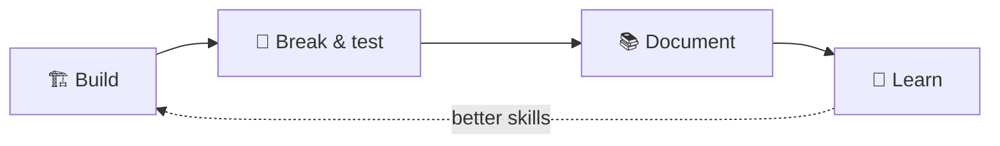

<div align="center">

# 🚢 shipkit

**Agent skills that build, break, document and hand off software, and get better with every project.**

[](https://github.com/kshanxs/shipkit/actions/workflows/test.yml)


[](LICENSE)

Claude Code · Cursor · Codex · Trae · any stack

</div>

---

Coding agents are fast, and they forget. They skip the tenant check, ship without a test, leave the
changelog stale, and repeat last month's mistake. **shipkit** is my answer: 25 skills an agent follows
literally, a few dependency-free scripts for the mechanical parts, and a loop that turns every lesson
from real work back into better skills.



## ⚡ Quick start

```bash
git clone https://github.com/kshanxs/shipkit
./shipkit/install.sh path/to/your-project
```

Ask your agent for `/profile` once, then just say **"run shipkit"**. The autopilot reads the
repository and runs what fits right now, and tells you what cannot run yet and why.

## 🎯 The taste behind it

- **Test first, then break it.** Every flaw found gets a failing test before the fix.
- **Docs are part of the change.** Changelog, spec and tracker move in the same commit.
- **Safe to run twice.** Check before changing, offer `--dry-run`, never delete by default.
- **No one's machine in the code.** No hardcoded user, host or secret.
- **Verify before claiming.** "Done" needs output you have actually read.

## 🧰 Skills

### Build

| Skill | | |
|---|---|---|
| [stack-backend](skills/stack-backend/) | `/api` | APIs: tenant isolation, transactions, migrations, tests |
| [stack-web](skills/stack-web/) | `/web` | Vite and Vite+ front ends: routing, server state, forms, accessibility |
| [stack-native](skills/stack-native/) | `/native` | React Native and Expo, with an offline-first database and sync |
| [stack-cli](skills/stack-cli/) | `/cli` | CLIs, scripts and infrastructure: safe re-runs, dry runs, unattended runs |
| [wire-api](skills/wire-api/) | `/wire` | Wire a screen to an endpoint without drift |
| [seedbed](skills/seedbed/) | `/seed` | Idempotent seed data for every feature |
| [fanout](skills/fanout/) | `/fanout` | Several agents in parallel worktrees, landed one at a time |

### Break & Test

| Skill | | |
|---|---|---|
| [harden](skills/harden/) | `/harden` | Test first, then break it on purpose |
| [bug-sweep](skills/bug-sweep/) | `/sweep` | Hunt for leaks, races and permission gaps; verify every finding |
| [load-sim](skills/load-sim/) | `/load` | Simulate many tenants' real traffic |
| [perf-watch](skills/perf-watch/) | `/perf` | Latency, slow queries and resources during a run |
| [triage-report](skills/triage-report/) | `/triage` | One severity-ranked report with evidence |
| [ship-check](skills/ship-check/) | `/ship` | Read-only launch-readiness audit |

### Docs & Flow

| Skill | | |
|---|---|---|
| [docsync](skills/docsync/) | `/docs` | The documentation contract, enforced by a checker and hooks |
| [feature-map](skills/feature-map/) | `/fmap` | What is built, by feature and tier |
| [open-loops](skills/open-loops/) | `/loops` | Open questions, anchored to the code |
| [handoff](skills/handoff/) | `/handoff` | Memory between agent sessions |
| [shipkit-feedback](skills/shipkit-feedback/) | `/skillfix` | Turn a lesson into a shipkit improvement |
| [switchboard](skills/switchboard/) | `/sb` | Routes each request to the right skills |
| [profile](skills/profile/) | `/profile` | Detects what the project is and writes `shipkit.toml` |

### Kits

One command runs a whole group, in order, skipping what does not fit.
[How kits decide →](docs/kits.md)

| Kit | | |
|---|---|---|
| [kit-build](skills/kit-build/) | `/build` | Only the stack skills the work touches |
| [kit-break](skills/kit-break/) | `/break` | Harden, sweep and report; `full` adds load, `launch` adds the audit |
| [kit-flow](skills/kit-flow/) | `/flow` | Close the session: docs, map, questions, handoff |
| [kit-feature](skills/kit-feature/) | `/feature` | Build, break, then flow |
| [autopilot](skills/autopilot/) | `/shipkit` | Say "run shipkit"; it picks the rest |

## 🧠 It learns from real projects

At the end of a session, the agent checks whether a skill misled it or taught it something new, and
drafts a general lesson on your machine. Nothing is posted unless you opt in, and every draft is
scrubbed of secrets, paths and names. [How it works →](docs/self_improvement.md)

## 📖 Docs

| | |
|---|---|
| [Install](docs/install.md) | Per project or once for every project, options, by hand |
| [Configuration](docs/configuration.md) | `shipkit.toml` and the project profile |
| [Kits and the autopilot](docs/kits.md) | How steps are planned, skipped and blocked |
| [How the skills work](docs/how_it_works.md) | Loading, scripts, hand-offs, routing, with diagrams |
| [Slash commands](docs/commands.md) | Every short name |
| [Self-improvement](docs/self_improvement.md) | The feedback loop and its privacy rules |
| [Development](docs/development.md) | Tests and checks for working on shipkit |

## 🤝 Contributing

A lesson from real work is the most useful contribution.
[Open an issue](https://github.com/kshanxs/shipkit/issues/new/choose) or read
[CONTRIBUTING.md](CONTRIBUTING.md). Report vulnerabilities through [SECURITY.md](SECURITY.md).

[MIT](LICENSE)
