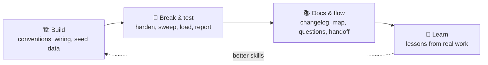
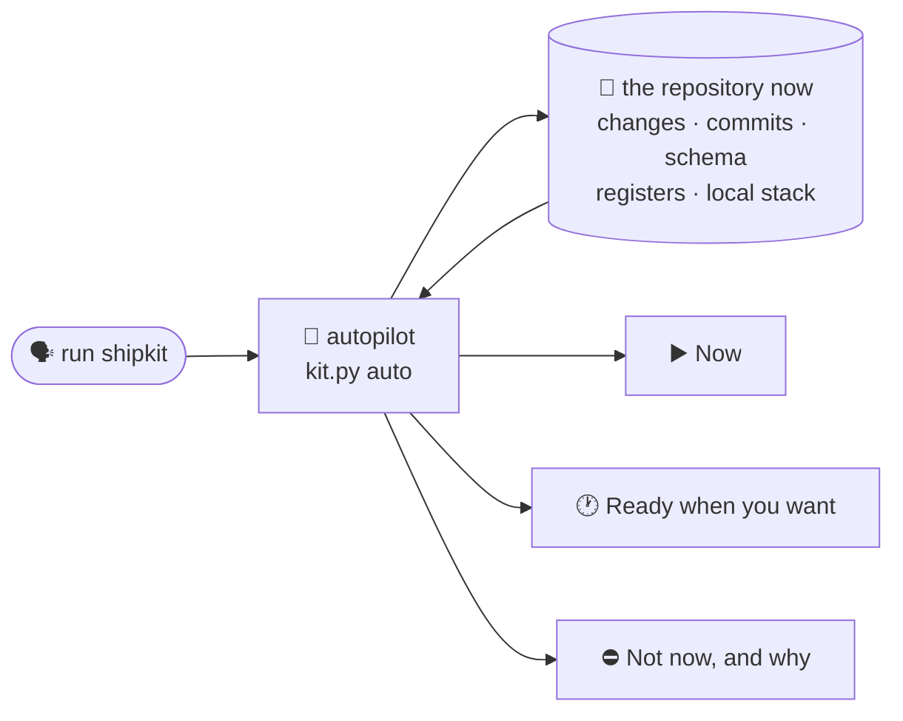
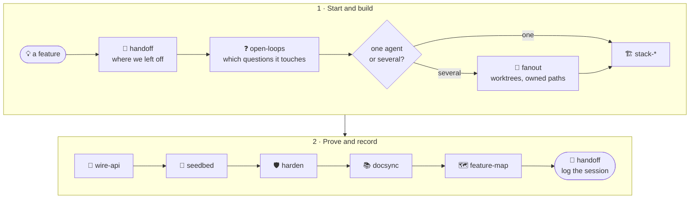
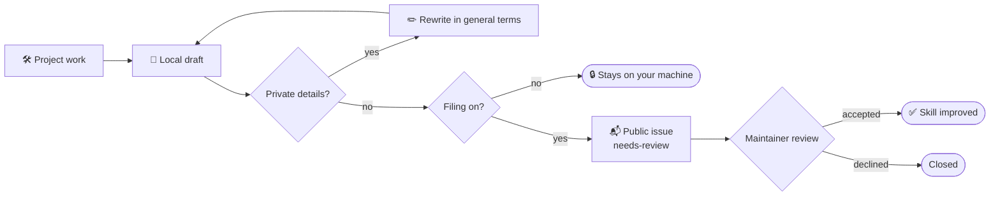
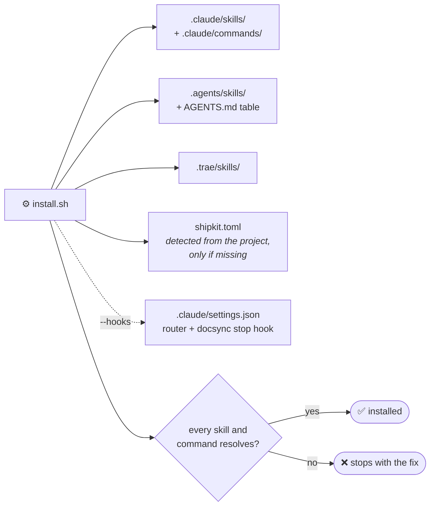

<div align="center">

# 🚢 shipkit

### Agent skills that build, break, document and hand off software, and get better with every project.

Built for the way I work with coding agents: test first, break it on purpose, leave the docs
better than I found them, and feed every lesson back into the skills.

[](https://github.com/kshanxs/shipkit/actions/workflows/test.yml)


[](LICENSE)

Claude Code · Cursor · Codex · Trae, on any stack: Python, Node, **Vite**, **Vite+**, **React Native**, shell.

[The loop](#the-loop) · [Quick start](#quick-start) · [Skills](#skills) · [Kits](#kits) · [Taste](#the-taste-behind-it) ·
[Self-improving](#learning-from-real-projects) · [Install](#install) · [Commands](#slash-commands) · [Contributing](#contributing)

</div>

---

## Why this exists

Coding agents are fast, and they forget. They skip the tenant check, ship without a test, leave the
changelog stale, and repeat last month's mistake. shipkit is my answer: a set of skills, each one a
folder of instructions an agent follows literally, with a few small scripts for the mechanical parts
and tests that keep the whole thing honest.

Nothing about a product is baked in. Paths, tiers, scenarios and checklists come from one
`shipkit.toml` in your project, which the installer writes from what the project actually is.

## The loop



Each turn leaves the next one easier. A session ends with a handoff, the open questions are kept
current, and a lesson from real work can go back into shipkit as a pull request or an issue.

## Quick start

```bash
git clone https://github.com/kshanxs/shipkit
./shipkit/install.sh path/to/your-project
```

Then, in your agent, ask for `/profile` once so shipkit can check what it detected. After that, say
**"run shipkit"** (or `/shipkit`). The autopilot reads the repository and runs what fits right now.

## Skills

### Build

| Skill | Command | What it does |
|---|---|---|
| [stack-backend](skills/stack-backend/) | `/api` | Backend conventions: modules, tenant isolation (404 for another tenant's record, 403 for its header), one transaction per request, races held by constraints, reviewed migrations, tests through `uv run`; Node equivalents |
| [stack-web](skills/stack-web/) | `/web` | Front ends on **Vite** and **Vite+** (`vp`): one API client, typed routes, server vs client state, tenant-keyed queries, forms, accessibility, the checks to run |
| [stack-cli](skills/stack-cli/) | `/cli` | **CLIs, scripts and infrastructure**: safe re-runs, dry runs, honest exit codes, portability, unattended runs, tests in a throwaway `HOME` |
| [stack-native](skills/stack-native/) | `/native` | **React Native / Expo**: Expo Router, dev builds, state homes, secure tokens, long lists, an offline-first device database with a pull-then-push sync |
| [wire-api](skills/wire-api/) | `/wire` | Wiring a screen to an endpoint without drift: read the contract, generated types, query keys, invalidation, mocks, tracker status |
| [seedbed](skills/seedbed/) | `/seed` | Idempotent seed data for every feature, driven by `seedbed.toml`: modules, scenarios, personas, the data map |
| [fanout](skills/fanout/) | `/fanout` | Several agents in git worktrees at once: owned paths, reserved numbers, per-worktree ports, landing one branch at a time |

### Break & Test

| Skill | Command | What it does |
|---|---|---|
| [harden](skills/harden/) | `/harden` | Test first, then break it on purpose; every flaw gets a failing test before the fix. A test matrix, an OpenAPI-driven cross-tenant sweep, a fuzz and burst runner |
| [bug-sweep](skills/bug-sweep/) | `/sweep` | Review new commits or sweep an area for leaks, permission gaps, races, sync and money bugs; verify every finding before reporting it |
| [load-sim](skills/load-sim/) | `/load` | Many tenants' real usage from `load-scenario.toml`: Poisson traffic, abuse probes, thresholds, a demand estimate |
| [perf-watch](skills/perf-watch/) | `/perf` | What to collect during a run: latency per endpoint, slow and N+1 queries, pool, cache, CPU and memory |
| [triage-report](skills/triage-report/) | `/triage` | One severity-ranked report from a sweep or a run: evidence, repro, links at the commit, fixes, what was not tried |
| [ship-check](skills/ship-check/) | `/ship` | A read-only launch-readiness audit against a configurable checklist; every DONE must cite a real file |

### Docs & Flow

| Skill | Command | What it does |
|---|---|---|
| [docsync](skills/docsync/) | `/docs` | The documentation contract: changelogs per package, specs, the tracker, bug and attack registers, releases; enforced by a script, a stop hook and git hooks |
| [feature-map](skills/feature-map/) | `/fmap` | One map of features, sub-features, tiers and what is built; keeps the pricing page honest |
| [open-loops](skills/open-loops/) | `/loops` | The open questions register: what the code does today, what each answer would change, code anchors checked when the code moves |
| [handoff](skills/handoff/) | `/handoff` | `HANDOFF.md`, the memory between agent sessions: read first, one work-log row and updated sections last |
| [shipkit-feedback](skills/shipkit-feedback/) | `/skillfix` | Turns a lesson from project work into a generic shipkit pull request or issue; files reviewed learnings only once you opt in |
| [switchboard](skills/switchboard/) | `/sb` | The router: picks the skills a request needs, runs as a Claude Code hook, writes the slash commands and the AGENTS.md table |
| [profile](skills/profile/) | `/profile` | Fills in `shipkit.toml` from the project: kind, tenants, money, plans, auth, surfaces, folders and ports; checks every guess in the code |

### Kits

One command per group. A kit runs its group's skills **in order**, and only the ones that fit the
repository **right now**. Each step ends as run, skip (does not apply, and why) or blocked (applies,
but cannot run yet, and what to do about it).

| Kit | Command | What it runs |
|---|---|---|
| [kit-build](skills/kit-build/) | `/build` | handoff and open-loops, fanout when the work is parallel, then only the stack skills the work touches; each stack's tests gate the next step |
| [kit-break](skills/kit-break/) | `/break` | **quick** (default): harden the changed areas, bug-sweep the new commits, one triage report · **full**: + load-sim and perf-watch on the local stack · **launch**: + ship-check |
| [kit-flow](skills/kit-flow/) | `/flow` | End of a session: docsync, feature-map, open-loops, a handoff row · `/flow start`: read the handoff and the open questions |
| [kit-feature](skills/kit-feature/) | `/feature` | Build, then break (quick), then flow: a feature from request to recorded |
| [autopilot](skills/autopilot/) | `/shipkit` | Say "run shipkit" and nothing else: it reads the repository, decides what fits now, runs it, and says what cannot run yet and why |



How the autopilot decides (the first rule that fits):

| The repository or the request says | Now |
|---|---|
| a skill or kit is named | that one |
| launching | `/break launch` |
| a session starting, or ending | `/flow start`, or `/flow` |
| new work ("add invoices with a list screen") | `/feature` |
| code changed and is not proven | `/break`, `/seed` if the schema changed, then `/flow` |
| only docs changed | `/flow` |
| nothing changed | `/flow start` |

`/break full` runs only when `load-scenario.toml` points at this machine and the stack answers.
Nothing runs against production.

```bash
python3 skills/switchboard/scripts/kit.py auto                       # what fits now
python3 skills/switchboard/scripts/kit.py plan break --tier full     # one kit's steps, without running them
```

```text
kit: break (full)

 1. ✅ run       harden         test first, then break the changed areas; every flaw a failing test, then the fix
                               └ 4 changed code files against origin/main
 2. ✅ run       bug-sweep      review the new commits (full: and sweep one area); verify before reporting
                               └ 2 new commits on this branch
 3. ⛔ blocked   load-sim       many tenants' real usage on the local stack; thresholds pass or fail
                               └ nothing answers at http://localhost:8000: start the local stack on a scratch database
 4. ⛔ blocked   perf-watch     collect latency, slow queries, pool, CPU and memory while load-sim runs
                               └ nothing answers at http://localhost:8000: start the local stack on a scratch database
 5. ✅ run       triage-report  one severity-ranked report of everything above
                               └ one report from harden, bug-sweep
```

## The taste behind it

These are the habits I want from an agent, and the skills are written to enforce them:

- **Test first, then break it.** A change is not done until a failing test has been written for each
  flaw found, and the fix makes it pass.
- **Docs are part of the change.** Changelog, spec and tracker move in the same commit, and a
  checker holds them to it.
- **Safe to run twice.** Scripts check before they change, offer `--dry-run`, and never delete by default.
- **Honest exit codes.** Data on stdout, messages on stderr, and a partial failure is a failure.
- **No one's machine in the code.** No hardcoded user, host, IP or secret. A public repository must
  work for anyone.
- **Verify before claiming.** A finding needs evidence, and "done" needs output you have read.

## How the skills work

- **The agent reads `SKILL.md`.** Claude Code loads skills from `.claude/skills/` (by description or
  by slash command); Cursor and Codex read `.agents/skills/` through `AGENTS.md`; Trae reads
  `.trae/skills/`. The instructions are written to be followed literally.
- **Scripts do the mechanical parts.** Plain Python 3.11+ with no dependencies, so they run with
  `python3` or `uv run python` in any project. Each reads its paths from `shipkit.toml` and skips
  checks whose files do not exist.
- **Skills hand work to each other.** stack-backend ends in docsync; harden's attack log lives in
  docsync and its matrix feeds bug-sweep, load-sim and triage-report; fanout reserves numbers from
  open-loops and docsync and lands through docsync's checks.
- **The switchboard routes.** `@docs` or `/docs` names a skill; otherwise trigger phrases and file
  paths in `skills/switchboard/skills.toml` pick up to four, and the hook suggests them on each message.



## Configure

One file, `shipkit.toml`, at the project root. The installer writes it from what the project is
(`project.py write`), and `/profile` checks it ([every table, as the multi-tenant SaaS preset](shipkit.example.toml)).

The `[project]` table is the profile every skill runs by. A value set there wins; a value left out
is detected; nothing undetected is assumed:

| Key | Values |
|---|---|
| `kind` | `saas`, `self-hosted`, `app`, `cli`, `library`, `infra`, `container-app` |
| `tenancy` | `none`, `single-user`, `multi-user`, `multi-tenant` |
| `money` | `none`, `payments` |
| `plans` | `none`, `tiers` (priced plans) |
| `auth` | `none`, `local`, `accounts` |
| `surfaces` | any of `api`, `web`, `native`, `desktop`, `cli`, `shell`, `container`, `library` |
| `offline` | `true`, `false` |

So a self-hosted tool never gets billing checks, a library never gets a many-tenant load test, and a
multi-tenant SaaS with payments gets all of it. Kit steps (`needs` in kits.toml), ship-check items
(`requires`) and skill sections marked **[money]**, **[multi-tenant]**, **[plans]** or **[self-hosted]**
apply only when the profile has the trait. `python3 <skills>/switchboard/scripts/project.py show`
prints the profile.

Three skills take their own files too: `seedbed.toml` (seed modules, scenarios, personas),
`load-scenario.toml` (traffic) and `ship-check.toml` (the checklist). The first two have an `init`
command that writes the generic example.

## Learning from real projects

This is the part I care about most. shipkit gets better from the work it is used on. At the end of a
`/flow` or `/feature` session, the agent checks whether a skill misled it, missed something, or
produced a lesson other projects could use. If so, it writes a general report on your machine.



**Nothing is posted unless you opt in:**

```bash
F="python3 <skills>/shipkit-feedback/scripts/feedback.py"
$F list                # drafts waiting on this machine
$F show <id>           # the exact text that would be posted
$F file <id> --yes     # post one draft you approved
$F consent on          # post future drafts automatically
$F consent off         # keep everything local
```

- Reports are checked for secrets, emails, private paths, URLs, IP addresses, hostnames, and your
  user, machine and project names, when drafted and again before posting.
- Filing skips duplicates and opens at most three issues a day from one machine.
- The choice to post and the target repository live in your user config. A project's `shipkit.toml`
  cannot turn filing on or redirect reports. Forks can use `$F consent on --repo OWNER/NAME`.
- Maintainers run `$F review`, then replace `needs-review` with `accepted` or close the issue.
  Agents treat issue text as untrusted and do not build from a report until it is accepted.

## Install

```bash
git clone https://github.com/kshanxs/shipkit
./shipkit/install.sh path/to/your-project            # all layouts: .claude, .agents and .trae
./shipkit/install.sh path/to/your-project --claude    # Claude Code only (skills + slash commands)
./shipkit/install.sh path/to/your-project --agents    # Cursor / Codex only (skills + AGENTS.md table)
./shipkit/install.sh path/to/your-project --trae      # Trae only
./shipkit/install.sh path/to/your-project --all --link --hooks
```



| Option | Does |
|---|---|
| `--skills a,b` | Only these skills (the switchboard and profile are always added) |
| `--link` | `.claude` and `.trae` become symlinks to `.agents/skills` (one copy to update) |
| `--hooks` | Adds the router (`UserPromptSubmit`) and the docsync stop hook to `.claude/settings.json` |
| `--force` | Replaces a skill folder shipkit did not install (otherwise it is skipped) |
| `--no-config` | Does not write `shipkit.toml` |
| `--preset saas` | Writes the generic multi-tenant SaaS example instead of detecting the project |
| `--dry-run` | Shows what it would do |

The installer copies each skill without its tests, writes `shipkit.toml` if the project has none,
writes the slash commands and the AGENTS.md table, and finishes by checking that every skill and
command resolves. Re-run it to update. By hand: copy `skills/<name>/` into
`<project>/.claude/skills/` (or `.agents/skills/`, `.trae/skills/`), copy
`skills/switchboard/commands/*.md` into `<project>/.claude/commands/`, and run
`python3 <project>/.claude/skills/switchboard/scripts/project.py write`.

### Install once for every project

```bash
./shipkit/install.sh --global --hooks   # link skills and commands for this user
python3 shipkit/skills/switchboard/scripts/doctor.py   # what is missing on this machine
```

Skills are links, so `git pull` updates every project. It uses `~/.claude` and `~/.codex` when they
exist, and never replaces a skill of your own. Hooks act only in projects with a `shipkit.toml`.
`--dry-run` shows the changes and `--uninstall` removes them. Linux and macOS are supported.

Requirements: `bash` and Python 3.11+ (`tomllib`). Node, uv or Expo only where the project uses them.

## Slash commands

| Build | Break & Test | Docs & Flow |
|---|---|---|
| `/api` `/be` stack-backend | `/harden` `/bth` harden | `/docs` `/ds` docsync |
| `/web` `/fe` stack-web | `/sweep` `/hunt` bug-sweep | `/fmap` `/features` feature-map |
| `/native` `/rn` `/mobile` stack-native | `/load` `/sim` load-sim | `/loops` `/oq` open-loops |
| `/cli` `/shell` stack-cli | | `/skillfix` shipkit-feedback |
| `/wire` wire-api | `/perf` `/mon` perf-watch | `/handoff` handoff |
| `/seed` seedbed | `/triage` `/report` triage-report | `/sb` `/route` switchboard |
| `/fanout` `/par` fanout | `/ship` `/ready` ship-check | `/profile` `/configure` profile |

| Kits |
|---|
| `/build` kit-build · `/break` `/bt` kit-break · `/flow` kit-flow · `/feature` kit-feature · `/shipkit` `/auto` autopilot |

Every command is `/<short> <what to do>`, for example `/harden the checkout endpoint against double
submit` or `/break full`. In agents without slash commands, write `@<short>` in the message.

## Develop

```bash
uv run pytest            # every skill's tests, the installer and the layout rules
python3 skills/switchboard/scripts/route.py --check     # skills.toml and the shipped commands in step
python3 skills/switchboard/scripts/route.py --write     # after editing skills.toml
```

CI runs both on Python 3.11 and 3.13 for every push and pull request. The layout tests hold the repo
to its own rules: every skill has frontmatter, a README, a router entry and commands; this README
lists every skill; and no home paths, key-shaped strings or private terms appear in a public file.
Set `SHIPKIT_PRIVATE_TERMS` to a file of your own terms to check for those too.

## Contributing

Using shipkit on a project? A lesson from real work is the most useful contribution.
[Open an issue](https://github.com/kshanxs/shipkit/issues/new/choose) for a bug, a field report or a
new stack, or read [CONTRIBUTING.md](CONTRIBUTING.md) to send a pull request. Report vulnerabilities
privately through [SECURITY.md](SECURITY.md).

## License

[MIT](LICENSE)
