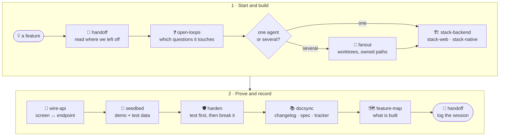
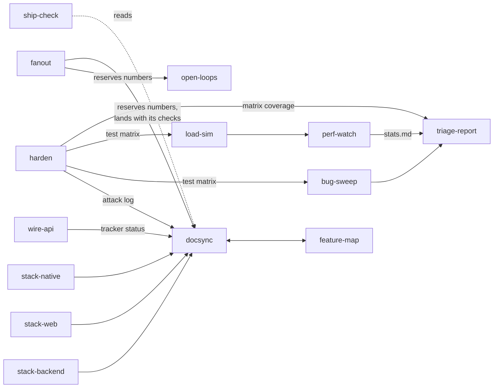
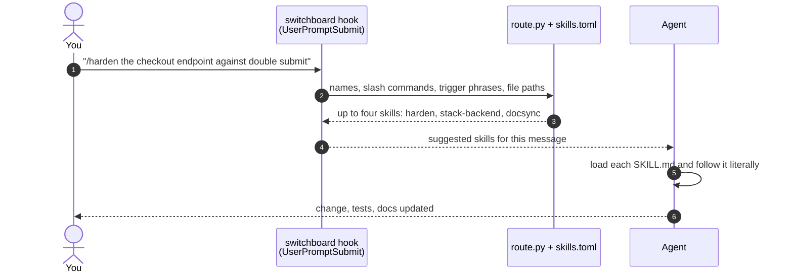
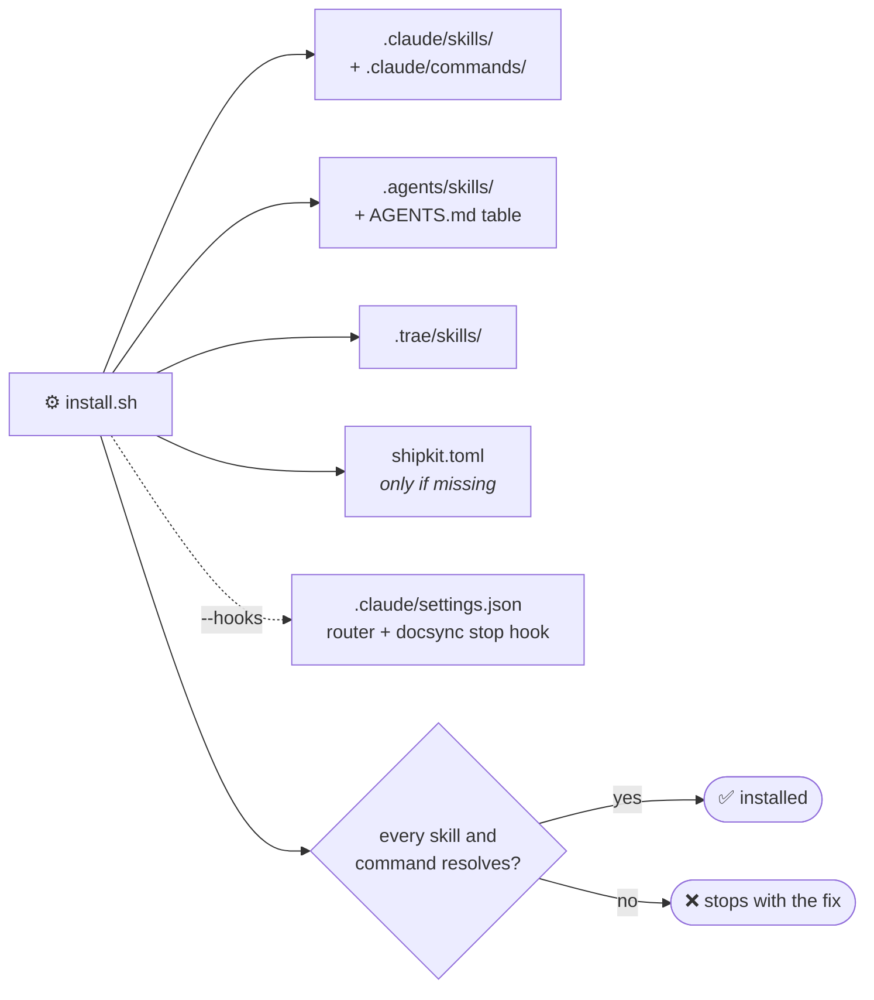
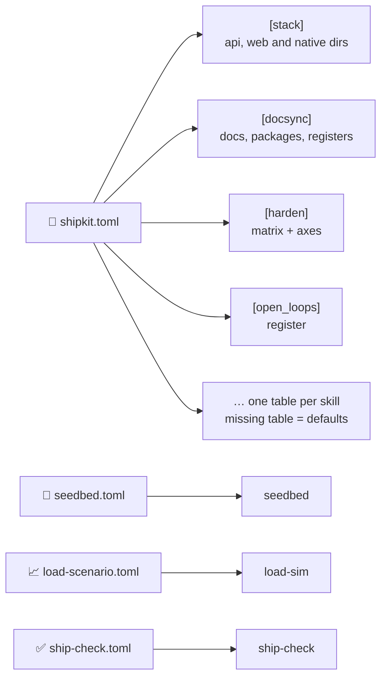

<div align="center">

# 🚢 shipkit

**Seventeen stack-agnostic skills that teach coding agents to build, break, test, document and hand
off work on real projects.**

[](https://github.com/kshanxs/shipkit/actions/workflows/test.yml)


[](LICENSE)


· on **uv/Python**, **Vite**, **Vite+** and **React Native**

[Skills](#skills) · [How they work](#how-the-skills-work) · [Install](#install) ·
[Slash commands](#slash-commands) · [Configure](#configure) · [Develop](#develop)

</div>

---

Each skill is a folder with a `SKILL.md` (the instructions the agent follows), a short `README.md`,
and where it helps, standard-library Python scripts, references and tests. Nothing about a
particular product is baked in: paths, tiers, scenarios and checklists come from one `shipkit.toml`
in your project, and the defaults are a generic multi-tenant SaaS app (workspaces, members, projects,
billing).

```mermaid
flowchart LR
    subgraph build["🏗️ Build"]
        direction TB
        be["stack-backend"]
        web["stack-web"]
        rn["stack-native"]
        wire["wire-api"]
        seed["seedbed"]
        fan["fanout"]
    end
    subgraph test["🧪 Break and Test"]
        direction TB
        harden["harden"]
        sweep["bug-sweep"]
        load["load-sim"]
        perf["perf-watch"]
        triage["triage-report"]
        ship["ship-check"]
    end
    subgraph flow["📚 Docs and Flow"]
        direction TB
        docs["docsync"]
        fmap["feature-map"]
        loops["open-loops"]
        hand["handoff"]
        sb["switchboard"]
    end
    build --> test --> flow
    flow -. "next session" .-> build
```



## Skills

### Build

| Skill | Command | What it does |
|---|---|---|
| [stack-backend](skills/stack-backend/) | `/api` | Backend conventions: modules, tenant isolation (404 for another tenant's record, 403 for its header), one transaction per request, races held by constraints, reviewed migrations, cache and time rules, tests through `uv run`; Node equivalents |
| [stack-web](skills/stack-web/) | `/web` | Front ends on **Vite** and **Vite+** (`vp`): one API client, typed routes, server vs client state, tenant-keyed queries, forms, accessibility, the checks to run |
| [stack-native](skills/stack-native/) | `/native` | **React Native / Expo**: Expo Router, dev builds, state homes, secure tokens, long lists, an offline-first device database with a pull-then-push sync protocol |
| [wire-api](skills/wire-api/) | `/wire` | Wiring a screen to an endpoint without drift: read the contract, generated types, query keys, invalidation, mocks, tracker status |
| [seedbed](skills/seedbed/) | `/seed` | Idempotent seed data for every feature, driven by a scenario config (`seedbed.toml`): modules, scenarios, personas, the data map; `check_seeds.py` and a runnable example seed |
| [fanout](skills/fanout/) | `/fanout` | Several agents in git worktrees at once: a plan with owned paths and reserved numbers, briefs, per-worktree ports and installs, landing one branch at a time with re-chained migrations |

### Break & Test

| Skill | Command | What it does |
|---|---|---|
| [harden](skills/harden/) | `/harden` | Test first, then break it on purpose; every flaw a failing test before the fix. A test matrix with pairwise cases, an OpenAPI-driven cross-tenant sweep, a fuzz and burst runner |
| [bug-sweep](skills/bug-sweep/) | `/sweep` | Review new commits or sweep an area for leaks, permission gaps, races, sync and money bugs, from the matrix's gaps; verify before reporting |
| [load-sim](skills/load-sim/) | `/load` | Many tenants' real usage from a scenario config (`load-scenario.toml`): Poisson traffic, profiles, replayed changes, abuse probes, thresholds, demand estimate; a stub server to prove the harness |
| [perf-watch](skills/perf-watch/) | `/perf` | What to collect during a run: latency per endpoint, slow and N+1 queries, pool, cache, CPU and memory, duplicates, growth per tenant |
| [triage-report](skills/triage-report/) | `/triage` | One severity-ranked report from a sweep or a run: evidence, repro, links at the commit, fixes, matrix coverage, what was not tried |
| [ship-check](skills/ship-check/) | `/ship` | A read-only launch-readiness audit against a configurable checklist; every DONE must cite a real file |

### Docs & Flow

| Skill | Command | What it does |
|---|---|---|
| [docsync](skills/docsync/) | `/docs` | The documentation contract: changelogs per package, specs, the tracker, bug and attack registers, releases; `check_docs.py` as a script, a stop hook and git hooks |
| [feature-map](skills/feature-map/) | `/fmap` | One map of features, sub-features, tiers and what is built; holds the pricing page to it and generates the public catalog |
| [open-loops](skills/open-loops/) | `/loops` | The open questions register, with what the code does today, what each answer changes, and code anchors that are checked when the code moves |
| [handoff](skills/handoff/) | `/handoff` | `HANDOFF.md`, the memory between agent sessions: read first, one work log row and updated sections last; Notion as an optional adapter |
| [switchboard](skills/switchboard/) | `/sb` | The router: picks the skills a request needs, runs as a Claude Code hook, writes the slash commands and the AGENTS.md table |

## How the skills work

- **The agent reads `SKILL.md`.** Claude Code loads skills from `.claude/skills/` (by their
  description, or by a slash command); Cursor and Codex read `.agents/skills/` through `AGENTS.md`;
  Trae reads `.trae/skills/`. The instructions are written to be followed literally: what to read
  first, what to change, what to run, when it is done.
- **Scripts do the mechanical parts** and are plain Python 3.11+ with no dependencies, so they run
  with `python3` or `uv run python` in any project. Each takes its paths from `shipkit.toml` and
  skips checks whose files do not exist.
- **Skills hand work to each other.** stack-backend ends in docsync; harden records attacks in
  docsync's attack log and its matrix feeds bug-sweep, load-sim and triage-report; fanout reserves
  numbers from open-loops' and docsync's registers and lands with docsync's checks.
- **The switchboard routes.** `@docs` or `/docs` names a skill; otherwise trigger phrases and file
  paths in `skills/switchboard/skills.toml` pick up to four, and the hook suggests them on each
  message.

### A feature, end to end



### How the skills hand off



### How the switchboard routes a message



## Install

```bash
git clone https://github.com/kshanxs/shipkit
./shipkit/install.sh path/to/your-project            # all layouts: .claude, .agents and .trae
./shipkit/install.sh path/to/your-project --claude    # Claude Code only (skills + slash commands)
./shipkit/install.sh path/to/your-project --agents    # Cursor / Codex only (skills + AGENTS.md table)
./shipkit/install.sh path/to/your-project --trae      # Trae only
./shipkit/install.sh path/to/your-project --all --link --hooks
```



| Option | Does |
|---|---|
| `--skills a,b` | Only these skills (the switchboard is always added) |
| `--link` | `.claude` and `.trae` become symlinks to `.agents/skills` (one copy to update) |
| `--hooks` | Adds the router (`UserPromptSubmit`) and the docsync stop hook to `.claude/settings.json` |
| `--force` | Replaces a skill folder shipkit did not install (otherwise it is skipped) |
| `--no-config` | Does not write `shipkit.toml` |
| `--dry-run` | Shows what it would do |

The installer copies each skill without its tests, writes `shipkit.toml` from
[shipkit.example.toml](shipkit.example.toml) if the project has none, writes the slash commands and
the AGENTS.md table, and finishes by checking that every skill and command resolves. Re-run it to
update. By hand: copy `skills/<name>/` into `<project>/.claude/skills/` (or `.agents/skills/`,
`.trae/skills/`), copy `skills/switchboard/commands/*.md` into `<project>/.claude/commands/`, and
copy `shipkit.example.toml` to `<project>/shipkit.toml`.

> [!TIP]
> Skills can also be installed once for every project, as symlinks into `~/.claude/skills/` (or
> `~/.codex/skills/`) pointing at a clone of this repo. A `git pull` then updates every project. The
> per-project slash commands and hooks still come from `install.sh`.

Requirements: `bash` and Python 3.11+ (`tomllib`). Node, uv or Expo only where the project uses them.

## Slash commands

| Build | Break & Test | Docs & Flow |
|---|---|---|
| `/api` `/be` stack-backend | `/harden` `/bth` harden | `/docs` `/ds` docsync |
| `/web` `/fe` stack-web | `/sweep` `/hunt` bug-sweep | `/fmap` `/features` feature-map |
| `/native` `/rn` `/mobile` stack-native | `/load` `/sim` load-sim | `/loops` `/oq` open-loops |
| `/wire` wire-api | `/perf` `/mon` perf-watch | `/handoff` handoff |
| `/seed` seedbed | `/triage` `/report` triage-report | `/sb` `/route` switchboard |
| `/fanout` `/par` fanout | `/ship` `/ready` ship-check | |

Every command is `/<short> <what to do>`, for example `/harden the checkout endpoint against double
submit`. In agents without slash commands, write `@<short>` in the message.

## Configure

One file, `shipkit.toml`, at the project root ([the generic SaaS example](shipkit.example.toml)).
Two skills also take their own scenario files: `seedbed.toml` (seed modules, scenarios, personas)
and `load-scenario.toml` (traffic); both have an `init` command that writes the generic example.
ship-check takes an optional `ship-check.toml` checklist.



## Develop

```bash
uv run pytest            # every skill's tests, the installer and the layout rules
python3 skills/switchboard/scripts/route.py --check     # skills.toml and the shipped commands in step
python3 skills/switchboard/scripts/route.py --write     # after editing skills.toml
```

CI runs both on Python 3.11 and 3.13 for every push and pull request. The layout tests also hold
the repo to its own rules: every skill has frontmatter, a README, a router entry and commands; this
README lists every skill; and no private names, home paths or key-shaped strings appear in a public file.

**Roadmap:** shipkit may later replace Zyralum's own project skills, once it covers them in daily use.

## License

[MIT](LICENSE)
