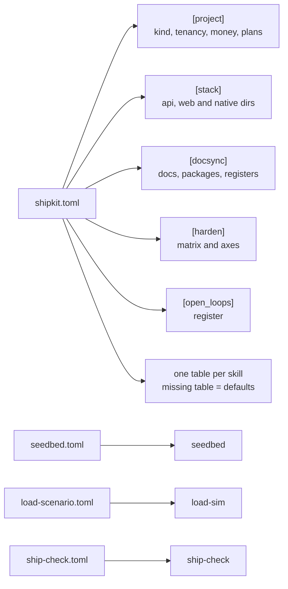

# Configuration

One file, `shipkit.toml`, at the project root. The installer writes it from what the project is
(`project.py write`), and `/profile` checks every guess against the code. See
[every table, as the multi-tenant SaaS preset](../shipkit.example.toml).

## The project profile

The `[project]` table is the profile every skill runs by. A value set there wins; a value left out
is detected; nothing undetected is assumed.

| Key | Values |
|---|---|
| `kind` | `saas`, `self-hosted`, `app`, `cli`, `library`, `infra`, `container-app` |
| `tenancy` | `none`, `single-user`, `multi-user`, `multi-tenant` |
| `money` | `none`, `payments` |
| `plans` | `none`, `tiers` (priced plans) |
| `auth` | `none`, `local`, `accounts` |
| `surfaces` | any of `api`, `web`, `native`, `desktop`, `cli`, `shell`, `container`, `library` |
| `offline` | `true`, `false` |

So a self-hosted tool never gets billing checks, a library never gets a many-tenant load test, and a
multi-tenant SaaS with payments gets all of it. Kit steps (`needs` in kits.toml), ship-check items
(`requires`) and skill sections marked **[money]**, **[multi-tenant]**, **[plans]** or
**[self-hosted]** apply only when the profile has the trait.

```bash
python3 <skills>/switchboard/scripts/project.py show        # print the profile
python3 <skills>/switchboard/scripts/project.py has money   # yes or no
```

## Other tables and files



Three skills take their own files: `seedbed.toml` (seed modules, scenarios, personas),
`load-scenario.toml` (traffic) and an optional `ship-check.toml` (the checklist). The first two have
an `init` command that writes the generic example.
