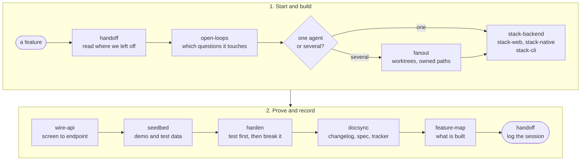
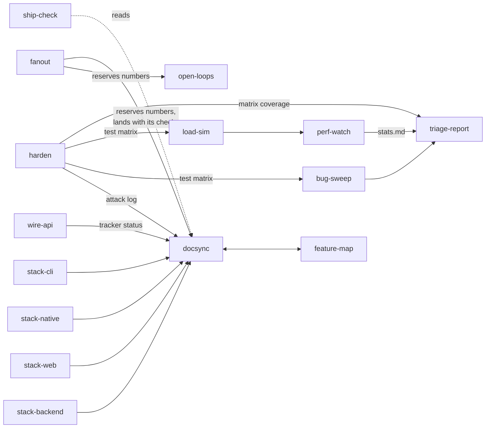
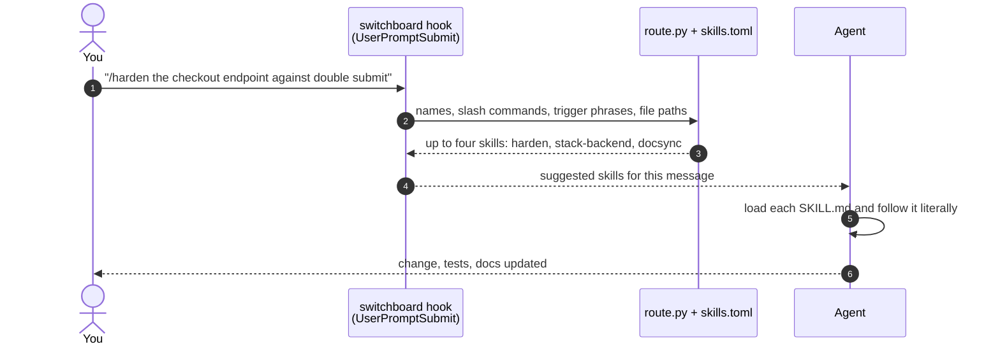

# How the skills work

Each skill is a folder with a `SKILL.md` (the instructions the agent follows), a short `README.md`,
and, where it helps, standard-library Python scripts, references and tests.

- **The agent reads `SKILL.md`.** Claude Code loads skills from `.claude/skills/` (by description or
  by slash command); Cursor and Codex read `.agents/skills/` through `AGENTS.md`; Trae reads
  `.trae/skills/`. The instructions are written to be followed literally: what to read first, what
  to change, what to run, and when it is done.
- **Scripts do the mechanical parts.** Plain Python 3.11+ with no dependencies, so they run with
  `python3` or `uv run python` in any project. Each reads its paths from `shipkit.toml` and skips
  checks whose files do not exist.
- **Skills hand work to each other.** stack-backend ends in docsync; harden's attack log lives in
  docsync and its matrix feeds bug-sweep, load-sim and triage-report; fanout reserves numbers from
  open-loops and docsync and lands through docsync's checks.
- **The switchboard routes.** `@docs` or `/docs` names a skill; otherwise trigger phrases and file
  paths in `skills/switchboard/skills.toml` pick up to four, and the hook suggests them on each
  message.

## The three groups

```mermaid
flowchart LR
    subgraph build["Build"]
        direction TB
        be["stack-backend"]
        web["stack-web"]
        rn["stack-native"]
        cli["stack-cli"]
        wire["wire-api"]
        seed["seedbed"]
        fan["fanout"]
    end
    subgraph test["Break and Test"]
        direction TB
        harden["harden"]
        sweep["bug-sweep"]
        load["load-sim"]
        perf["perf-watch"]
        triage["triage-report"]
        ship["ship-check"]
    end
    subgraph flow["Docs and Flow"]
        direction TB
        docs["docsync"]
        fmap["feature-map"]
        loops["open-loops"]
        hand["handoff"]
        sb["switchboard"]
        prof["profile"]
        feedback["shipkit-feedback"]
    end
    build --> test --> flow
    flow -. "next session" .-> build
```

## A feature, end to end

## How the skills hand off

## How the switchboard routes a message

