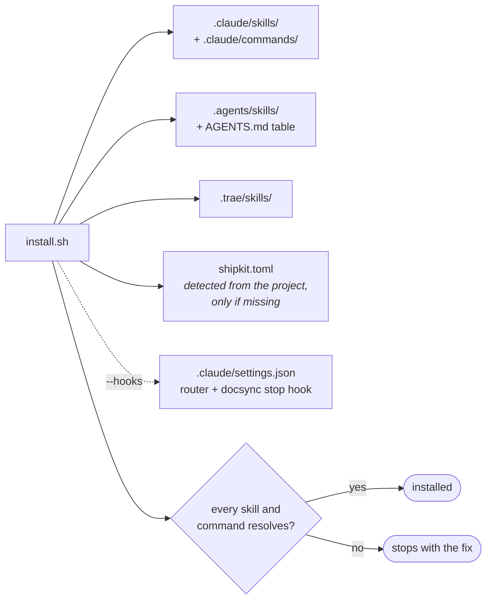

# Install

Requirements: `bash` and Python 3.11+ (`tomllib`). Node, uv or Expo only where the project uses
them. Linux and macOS are supported.

## Into one project

```bash
git clone https://github.com/kshanxs/shipkit
./shipkit/install.sh path/to/your-project            # all layouts: .claude, .agents and .trae
./shipkit/install.sh path/to/your-project --claude    # Claude Code only (skills + slash commands)
./shipkit/install.sh path/to/your-project --agents    # Cursor / Codex only (skills + AGENTS.md table)
./shipkit/install.sh path/to/your-project --trae      # Trae only
./shipkit/install.sh path/to/your-project --all --link --hooks
```



| Option | Does |
|---|---|
| `--skills a,b` | Only these skills (the switchboard and profile are always added) |
| `--link` | `.claude` and `.trae` become symlinks to `.agents/skills` (one copy to update) |
| `--hooks` | Adds the router (`UserPromptSubmit`) and the docsync stop hook to `.claude/settings.json` |
| `--force` | Replaces a skill folder shipkit did not install (otherwise it is skipped) |
| `--no-config` | Does not write `shipkit.toml` |
| `--preset saas` | Writes the generic multi-tenant SaaS example instead of detecting the project |
| `--dry-run` | Shows what it would do |

The installer copies each skill without its tests, writes `shipkit.toml` from what the project is
(`project.py write`) if the project has none, writes the slash commands and the AGENTS.md table, and
finishes by checking that every skill and command resolves. Then ask your agent for `/profile` (or
`@profile`): it checks the detected values against the code and asks only what the code cannot
answer. Re-run the installer to update.

## Once for every project

```bash
./shipkit/install.sh --global --hooks                  # link skills and commands for this user
python3 shipkit/skills/switchboard/scripts/doctor.py   # what is missing on this machine
```

Skills are links, so `git pull` updates every project. It uses `~/.claude` and `~/.codex` when they
exist, and never replaces a skill of your own. Hooks act only in projects with a `shipkit.toml`.
`--dry-run` shows the changes and `--uninstall` removes them.

## By hand

Copy `skills/<name>/` into `<project>/.claude/skills/` (or `.agents/skills/`, `.trae/skills/`), copy
`skills/switchboard/commands/*.md` into `<project>/.claude/commands/`, and run
`python3 <project>/.claude/skills/switchboard/scripts/project.py write`.
