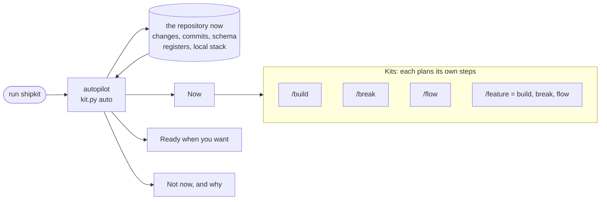

# Kits and the autopilot

A kit runs one group's skills **in order**, and only the ones that fit the repository **right now**.
Each step ends as one of three states:

| State | Meaning |
|---|---|
| run | The step applies and runs |
| skip | The step does not apply, and the reason is given |
| blocked | The step applies but cannot run yet, with what to do about it |

| Kit | Command | What it runs |
|---|---|---|
| kit-build | `/build` | handoff and open-loops, fanout when the work is parallel, then only the stack skills the work touches, wire-api when an API and a screen both change, seedbed when the data model changes; each stack's tests gate the next step |
| kit-break | `/break` | **quick** (default): harden the changed areas, bug-sweep the new commits, one triage report. **full**: adds load-sim with perf-watch on the local stack. **launch**: adds ship-check |
| kit-flow | `/flow` | End of a session: docsync, feature-map, open-loops, a handoff log row. `/flow start` reads the handoff and the open questions |
| kit-feature | `/feature` | Build, then break (quick), then flow: a feature from request to recorded |

## The autopilot

Say "run shipkit" (or `/shipkit`) and nothing else. The autopilot reads the repository, decides which
kits and skills fit now, runs them, and says what cannot run yet and why.



How it decides (the first rule that fits):

| The repository or the request says | Now |
|---|---|
| a skill or kit is named | that one |
| launching | `/break launch` |
| a session starting, or ending | `/flow start`, or `/flow` |
| new work ("add invoices with a list screen") | `/feature` |
| code changed and is not proven | `/break`, `/seed` if the schema changed, then `/flow` |
| only docs changed | `/flow` |
| nothing changed | `/flow start` |

`/break full` is offered only when `load-scenario.toml` points at this machine and the stack answers;
anywhere else it is held back with the reason. Nothing runs against production.

## Planning without running

```bash
python3 skills/switchboard/scripts/kit.py auto                       # what fits now
python3 skills/switchboard/scripts/kit.py plan break --tier full     # one kit's steps, without running them
```

```text
kit: break (full)

 1. run       harden         test first, then break the changed areas; every flaw a failing test, then the fix
                             └ 4 changed code files against origin/main
 2. run       bug-sweep      review the new commits (full: and sweep one area); verify before reporting
                             └ 2 new commits on this branch
 3. blocked   load-sim       many tenants' real usage on the local stack; thresholds pass or fail
                             └ nothing answers at http://localhost:8000: start the local stack on a scratch database
 4. blocked   perf-watch     collect latency, slow queries, pool, CPU and memory while load-sim runs
                             └ nothing answers at http://localhost:8000: start the local stack on a scratch database
 5. run       triage-report  one severity-ranked report of everything above
                             └ one report from harden, bug-sweep
```

Steps whose traits the project profile lacks are skipped with the reason, through `needs` in
`skills/switchboard/kits.toml`. See [configuration](configuration.md).
