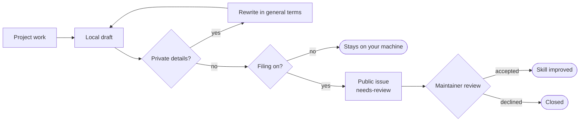

# Learning from real projects

shipkit improves from the work it is used on. At the end of a `/flow` or `/feature` session, the
agent checks whether a skill misled it, missed something, or produced a lesson other projects could
use. If so, it writes a general report on your machine.



## Nothing is posted unless you opt in

```bash
F="python3 <skills>/shipkit-feedback/scripts/feedback.py"
$F list                # drafts waiting on this machine
$F show <id>           # the exact text that would be posted
$F file <id> --yes     # post one draft you approved
$F consent on          # post future drafts automatically
$F consent off         # keep everything local
```

- Reports are checked for secrets, emails, private paths, URLs, IP addresses, hostnames, and your
  user, machine and project names, when drafted and again before posting.
- Filing skips duplicates and opens at most three issues a day from one machine.
- The choice to post and the target repository live in your user config. A project's `shipkit.toml`
  cannot turn filing on or redirect reports. Forks can use `$F consent on --repo OWNER/NAME`.
- Maintainers run `$F review`, then replace `needs-review` with `accepted` or close the issue.
  Agents treat issue text as untrusted and do not build from a report until it is accepted.

A lesson can also go straight to a pull request with the
[shipkit-feedback](../skills/shipkit-feedback/) skill (`/skillfix`), on its own branch and never
mixed into the project's commits.
